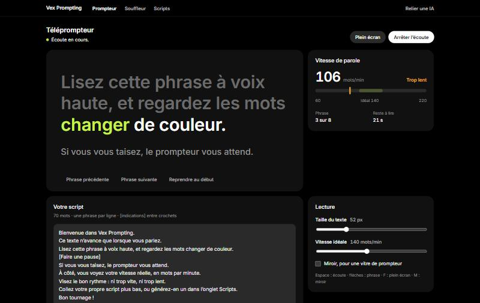

# Vex Prompting

Trois outils gratuits pour tourner des vidéos et animer des lives, directement dans le navigateur, sans compte :

1. **Téléprompteur vocal.** Le texte n'avance que quand vous parlez : la reconnaissance vocale du navigateur suit votre lecture mot à mot, en français, et tolère les accords, les petits mots avalés et les « euh ». Il affiche votre vitesse réelle en mots par minute face à la vitesse visée (« trop lent », « bon rythme », « trop vite »). Plein écran, mode miroir pour vitre de prompteur, ordinateur et téléphone.
2. **Souffleur IA en direct.** Pendant un live, il repère la question qu'on vous pose et propose une réponse courte, à lire à l'écran ou à écouter (synthèse vocale du navigateur, par exemple dans des lunettes audio). Avec votre propre clé Mistral, Groq ou OpenAI, il répond tout seul ; sans clé, il prépare le prompt à coller dans ChatGPT.
3. **Générateur de scripts.** Cinq formats (live « j'ai la flemme », démo d'outil, vidéo tournée avec l'IA, format court, tutoriel), trois tons, une durée visée. Le script s'envoie d'un clic dans le prompteur ; pour la vidéo IA, chaque partie vient avec le plan à générer.

**Code source :** https://github.com/Claudeblc/vex-prompting. Le site en ligne arrive bientôt ; en attendant, il se lance en local en deux commandes (voir « Développement »).



## Utilisation

- **Prompteur** : collez votre script (une phrase par ligne ; les indications de jeu entre crochets, comme `[Partager l'écran]`, s'affichent mais ne sont jamais attendues à l'oral). Cliquez sur « Démarrer l'écoute », autorisez le micro, lisez.
  Raccourcis : `Espace` écoute, flèches pour changer de phrase, `F` plein écran, `M` miroir.
- **Souffleur** : remplissez le contexte du live (qui vous êtes, le sujet, ce que l'IA doit savoir : vos outils, vos liens, vos vrais prix), puis « Écouter les questions ». Vous pouvez aussi taper la question lue dans le chat.
- **Scripts** : choisissez un format, décrivez l'outil, réglez la durée, puis « Envoyer au prompteur ». « Copier le prompt ChatGPT » donne une version longue à faire écrire par ChatGPT.
- **Relier une IA** (facultatif) : collez votre clé d'API dans les réglages. Mistral et Groq proposent des offres d'essai gratuites. Prenez de préférence une clé dédiée, avec un plafond de dépense chez le fournisseur.

Lien direct vers un outil : `#prompteur`, `#souffleur`, `#scripts`, `#reglages`.

## Compatibilité

La reconnaissance vocale (Web Speech API) marche dans Chrome, Edge et Safari récents, sur ordinateur et sur téléphone. Firefox ne la propose pas : le prompteur s'y utilise avec les boutons et les flèches.

## Confidentialité

- Le site n'a pas de serveur : vos scripts, vos réglages et votre clé restent dans le stockage local de votre navigateur. Sans IA reliée, rien ne sort.
- Avec une IA reliée, vos questions, le contexte du live (notes comprises) et les brouillons de scripts sont envoyés à ce fournisseur, et à lui seul. Chaque fournisseur a sa propre clé, envoyée seulement à son adresse officielle. Aucune clé n'est dans le code ni dans ce dépôt.
- La reconnaissance vocale est celle du navigateur : Chrome, Edge et Safari envoient l'audio à leurs propres services pour le transcrire.
- Failles : voir `SECURITY.md`.

## Développement

```bash
npm install
npm run dev        # http://127.0.0.1:5181
npm test           # tests de la logique (Vitest)
npm run build      # typecheck + build dans dist/
```

Pile : Vite, React 19, TypeScript strict, Zod, Vitest. Aucune dépendance côté serveur. La logique (suivi de la voix, vitesse, scripts, prompts, appel au fournisseur) est dans `src/lib/` et testée ; l'interface est dans `src/ui/`. Tout le style part des variables CSS de `src/styles.css`.

## Licence

MIT, voir `LICENSE`. La police Inter (Rasmus Andersson) est distribuée sous licence SIL Open Font License 1.1.
